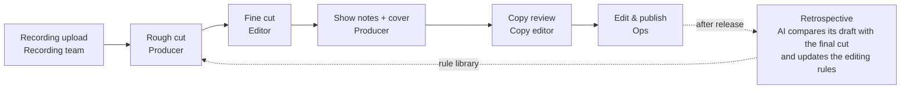

<div align="center">

# Podcast Assistant

**A collaborative workbench that takes a knowledge podcast episode from recording to release in one place.**

AI drafts every step first. The teammate responsible reviews the draft, and the episode then moves on to the next step automatically.

[中文](README.zh-CN.md) · [Website](https://rene-wang1024.github.io/podcast-assistant/) · [Deployment guide](docs/deploy.md) · [Editing rules](docs/editing-rules.md) · [Roadmap](#roadmap)

</div>

---

## Why

Many podcast teams hand off work like this:

> The recording team uploads to a cloud drive → the producer downloads, rough-cuts, and re-uploads → the editor downloads, fine-cuts, and re-uploads → the producer writes show notes → the ops teammate publishes everywhere

Every handoff becomes a "is it uploaded yet?" message in the group chat, and nobody can tell where an episode is stuck. AI gets used ad hoc on individual laptops, so lessons learned never accumulate.

Podcast Assistant turns each episode into a **pipeline**. Every step has a clear owner, a defined deliverable, and a known next person. When a step is marked done, the episode moves on and the next owner is @-mentioned in the team's WeCom (企业微信) group.

## Features

| | | |
|---|---|---|
| 🔁 **Automatic handoffs**<br>Click "Done" and the next step's owner is notified right away | 🤖 **AI drafts, humans review**<br>AI writes the first draft of each step; the owner edits and approves | 🔍 **Independent review**<br>A model from a different vendor checks each AI draft against the step's delivery standard |
| 🧩 **A different model per step**<br>Codex for rough cuts, GPT for cover art, Claude for writing; change any of them on the settings page | 📦 **Files move inside the workbench**<br>Raw video uploads in chunks and resumes after a dropped connection; the server extracts the audio and transcribes it | 💬 **WeCom notifications**<br>A group bot @-mentions the exact person, and sending a step back includes the reason |

## How an episode flows



| Step | Owner | Owner delivers | AI drafts | Default models |
|---|---|---|---|---|
| Recording upload | Recording team | Raw video, script, episode requirements | Audio extraction ✅ and transcript ✅ (server, no LLM) | FFmpeg, SenseVoice |
| Rough cut | Producer | Reviewed cut list, 1080p rough-cut video | Cut list (V2) | OpenAI Codex |
| Fine cut | Editor | Final video, final transcript | Fine-cut suggestions (V3) | Claude |
| Show notes + cover | Producer | Approved show notes and cover | Show notes ✅, cover (V3) | Claude, GPT Image |
| Copy review | Copy editor | Per-platform copy, checked for facts, wording and risk | Per-platform copy ✅ | GPT |
| Edit & publish | Ops | Posts edited and published on each platform, links pasted back | — (audio platforms sync via RSS) | — |
| Retrospective | Producer | Approved rule changes | Draft vs. final comparison (V3) | Claude |

**Downstream reviews upstream.** Before a step starts, its model first checks the previous step's output against that step's delivery standard. Adjacent steps use models from different vendors by default, so each one cross-checks the other.

## Works for any knowledge podcast

Law, history, science, business, psychology, and so on. Fill in your show profile under **Settings → Show profile**, and the AI output will fit your show:

- Show name, field, and format (solo, two hosts, panel, or interview)
- **Accuracy rules for your field**, e.g. "years and names must match the recording" or "keep the caveats on research findings"
- Disclaimer, distribution platforms, and cover style

[`examples/shows/`](examples/shows/) has ready-made profiles for a legal talk show, a history narration show, and a science interview show.

## Editing rules learned from final cuts

[`docs/editing-rules.md`](docs/editing-rules.md) holds editing rules for knowledge podcasts, written in Chinese. They come from comparing AI first drafts with human final cuts, edit by edit, across several episodes. The core ideas:

- **Trim the delivery, but keep every point and every example.** Decide sentence by sentence, never by cutting whole passages.
- A rough cut runs about 60–70% of the raw length, a final cut 55–65%, and an audio-platform version about 50%.
- Make each point once. Cut the second phrasing, the second analogy, and the recap after the point has been made.
- Cut speculation and hypotheticals even when they contain an opinion; keep facts and conclusions.

After each episode is finalized, the AI compares its own draft with the human final cut and proposes rule changes. **A change enters the rule library only after the producer approves it.**

## Quick start

**Try it locally (free, no model calls):**

```bash
git clone https://github.com/rene-wang1024/podcast-assistant.git && cd podcast-assistant
pip install -r requirements.txt
PIPELINE_PROVIDER_OVERRIDE=mock uvicorn app.main:app --port 8000
# Open http://127.0.0.1:8000, create the admin account, add members, create an episode
```

**Deploy for real:** follow the [deployment guide](docs/deploy.md) (in Chinese) to run it with Docker on a Singapore server. Teammates in mainland China and overseas can both reach it, no ICP filing is needed, and the server can call the OpenAI and Anthropic APIs.

## Roadmap

- [x] **V1 – Collaboration:** accounts and roles, per-episode handoffs, netdisk links and audio upload, WeCom notifications, sending a step back (admin), AI-drafted show notes and distribution copy with independent review
- [ ] **V2 – Files and AI rough cut**
  - [x] Large-file transfer inside the workbench: chunked upload, resume after a dropped connection, range downloads
  - [x] Server extracts audio (lossless FLAC, 16 kHz WAV, preview MP3) and transcribes it (SenseVoice, character-level timestamps)
  - [ ] Server renders the 1080p rough-cut video from the cut list (FFmpeg)
  - [ ] The producer's own Claude claims rough-cut tasks, runs the rough-cut skill and returns the cut list and preview
  - [ ] Reviewing cuts and listening to the preview in the browser
  - [ ] Object storage (Alibaba Cloud OSS) with browser-direct upload
- [ ] **V2.1:** after publishing, sync the raw video to Baidu Netdisk as an archive
- [ ] **V3:** AI fine-cut suggestions, AI cover art, post-release retrospectives and the rule library

## Project layout

```
app/            Web workbench (FastAPI + SQLite); the step definitions live in app/flow.py
pipeline/       AI module: model routing, prompt building, independent review, cut-list validation; also runs from the CLI
workflows/      Per-step role description, delivery standard, upstream checks, and prompt
config/         Model assignment (pipeline.yaml) and show profile (show.yaml)
docs/           Editing rules, cut-list format, deployment guide, website
examples/       Sample show profiles and a fictional sample episode
```

Using the AI module from the command line, without the web app:

```bash
python -m pipeline plan                                  # show which model each step uses
PIPELINE_PROVIDER_OVERRIDE=mock python -m pipeline run all --episode EP00
```

> The interface, prompts, and docs are in Chinese, since the tool targets Chinese-language podcasts. The code and configuration keys are in English.

## Development

```bash
pip install -r requirements.txt pytest httpx
pytest
```

## License

MIT
