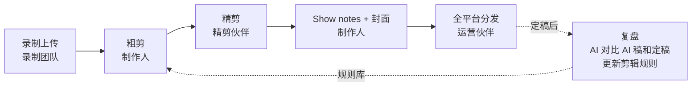

<div align="center">

# 播客协作工作台

**让一期知识类播客，在一个地方从录制走到发布。**

每一步 AI 先做初稿，负责的伙伴审核后自动交给下一步。

[English](README.md) · [介绍页](https://rene-wang1024.github.io/podcast-assistant/) · [部署指南](docs/deploy.md) · [剪辑规则](docs/editing-rules.md) · [路线图](#路线图)

</div>

---

## 为什么做这个

很多播客团队现在是这样交接的：

> 录制团队传网盘 → 制作人下载、粗剪、再传网盘 → 精剪伙伴下载、精剪、再传网盘 → 制作人写 Show notes → 运营伙伴分发

每一步都要在群里问一句“传好了吗”，没人说得清这一期卡在哪。AI 也只能在各人电脑上零散地用，经验沉淀不下来。

这个工作台把一期节目变成一条**流水线**：每一步有明确的负责人、要交什么、交给谁。完成后自动流转，并在企业微信群里 @ 下一位负责人。

## 功能一览

| | | |
|---|---|---|
| 🔁 **按步骤自动流转**<br>点“完成”后进入下一步，负责人立即收到通知 | 🤖 **AI 先做，人审核**<br>每一步由 AI 出初稿，负责人修改后再确认 | 🔍 **独立审查**<br>AI 初稿由另一家模型按交付标准逐条检查 |
| 🧩 **每一步配不同模型**<br>粗剪用 Codex，封面用 GPT 生图，文案用 Claude，在设置页随时可改 | 📦 **大文件不搬家**<br>视频仍放百度网盘，工作台只存链接和压缩音频 | 💬 **企业微信通知**<br>群机器人 @ 到具体的人，退回时附上原因 |

## 一期节目怎么走



| 步骤 | 负责人 | 负责人交什么 | AI 先做什么 | 默认模型 |
|---|---|---|---|---|
| 录制上传 | 录制团队 | 网盘链接、压缩音频、文稿、本期要求 | — | — |
| 粗剪 | 制作人 | 审核剪点方案、粗剪网盘链接 | 转写 + 剪点方案（V2） | SenseVoice + OpenAI Codex |
| 精剪 | 精剪伙伴 | 成品网盘链接、定稿文字稿 | 精剪建议（V3） | Claude |
| Show notes + 封面 | 制作人 | 审核后的 Show notes 和封面 | Show notes ✅、封面（V3） | Claude、GPT 生图 |
| 全平台分发 | 运营伙伴 | 审核后的文案、各平台发布链接 | 各平台文案 ✅ | GPT |
| 复盘 | 制作人 | 确认规则修改 | 对比 AI 稿和定稿（V3） | Claude |

**下游审上游**：每一步开工前，下游的模型会先按上游的交付标准检查一遍上游产出。上下游默认用不同厂商的模型，互相核对。

## 适用于任何知识类播客

法律、历史、科学、商业、心理学……在「设置 → 节目档案」里填好这些，AI 的输出就会贴合你的节目：

- 节目名、领域、形式（单人讲述 / 对谈 / 访谈）
- **领域准确性要求**：例如“年份、人名必须和录音一致”“研究结论保留限定条件”
- 免责声明、分发平台、封面风格

[`examples/shows/`](examples/shows/) 里有法律对谈、历史讲述、科普访谈三份现成的节目档案。

## 剪辑规则从定稿里学

[`docs/editing-rules.md`](docs/editing-rules.md) 是一套知识类播客的剪辑规则，来自多期节目「AI 第一稿 vs 人工定稿」的逐条对比。核心几条：

- **表达可以精简，观点和案例必须保留**；取舍以句子为单位，不按段落整段删。
- 粗剪约为原始时长的 60–70%，精剪定稿 55–65%，音频平台版约 50%。
- 同一个点只讲一遍：第二种说法、第二个类比、讲完之后的总结回指都删。
- 推测和假设即使带观点也删，事实和结论保留。

每期定稿后，AI 对比自己的稿和人工定稿，提出规则修改建议，**制作人确认后才写进规则库**。

## 快速开始

**本地试用（不花钱）**

```bash
git clone https://github.com/rene-wang1024/podcast-assistant.git && cd podcast-assistant
pip install -r requirements.txt
PIPELINE_PROVIDER_OVERRIDE=mock uvicorn app.main:app --port 8000
# 打开 http://127.0.0.1:8000，创建管理员 → 添加成员 → 新建一期
```

**正式部署**：按[部署指南](docs/deploy.md)在香港或新加坡服务器上用 Docker 部署，国内外伙伴都能访问，不需要备案。

## 路线图

- [x] **V1 跑通协作**：账号和角色、单期流转、网盘链接和音频上传、企业微信通知、管理员退回、AI 生成 Show notes 和分发文案（附独立审查）
- [ ] **V2 AI 粗剪**：服务器端语音转写（SenseVoice，逐字时间戳）、AI 剪点方案、网页审核剪点、本地小工具一键生成剪映草稿
- [ ] **V3**：AI 精剪建议、AI 封面、定稿复盘和规则库

## 项目结构

```
app/            网页工作台（FastAPI + SQLite），流程定义在 app/flow.py
pipeline/       AI 模块：模型路由、prompt 组装、独立审查、剪点方案校验；也可以单独用命令行跑
workflows/      每一步的岗位说明、交付标准、审上游要点和 prompt
config/         模型分配（pipeline.yaml）和节目档案（show.yaml）
docs/           剪辑规则、剪点方案格式、部署指南、介绍页
examples/       示例节目档案和一期虚构的示例素材
```

命令行用法（不开网页，直接跑 AI 模块）：

```bash
python -m pipeline plan                                  # 查看每一步用哪个模型
PIPELINE_PROVIDER_OVERRIDE=mock python -m pipeline run all --episode EP00
```

## 开发

```bash
pip install -r requirements.txt pytest httpx
pytest
```

## License

MIT
